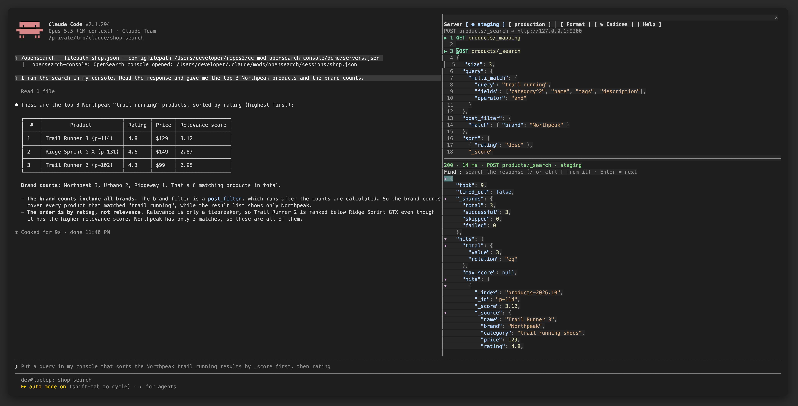
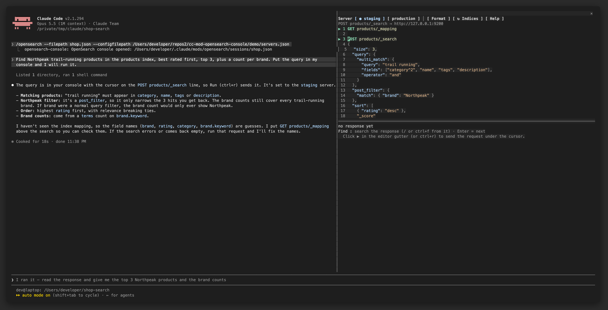
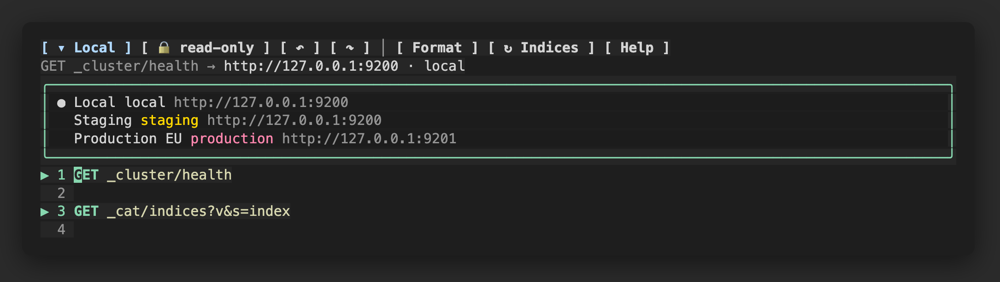
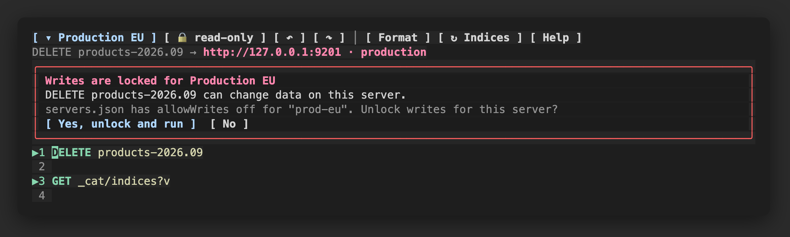
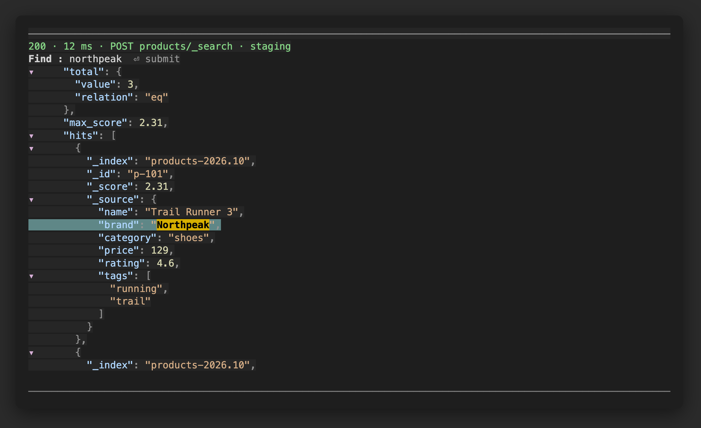
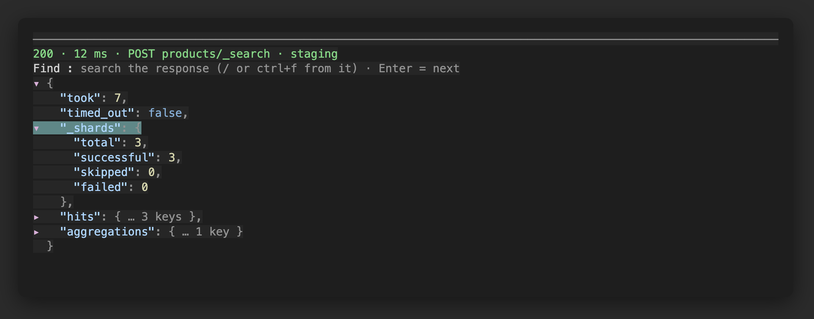
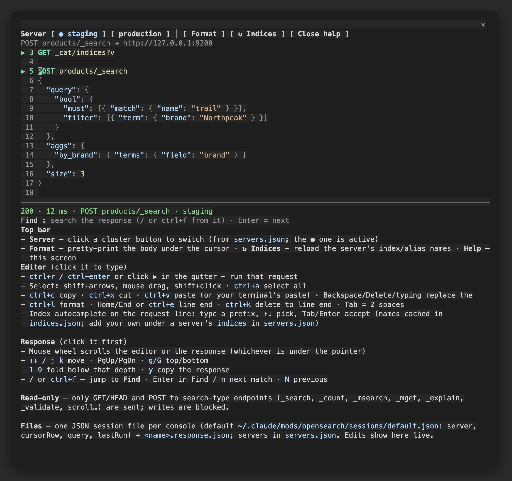

# OpenSearch & Elasticsearch Console: a Claude Code mod

A Kibana / OpenSearch Dashboards **Dev Tools-style console** for **OpenSearch and Elasticsearch** that lives in a Claude Code side pane.
Claude writes queries into it, you read, edit and run them, and Claude reads the response back.
Works with OpenSearch and Elasticsearch through the REST API they share, and **every write asks you first**.



## Why

When you debug a search index with an agent, the agent usually runs `curl` itself and you squint at JSON in the transcript.
This mod keeps you in the loop instead:

- **The agent proposes, you dispose.** Claude injects the query into the editor; you see it, tweak it, and press ▶ yourself.
- **A real response viewer.** Colored JSON with folding, search and copy, instead of a wall of text.
- **Nothing writes to your cluster unless you say so.** Every write shows you the exact request first (see [Writes are locked](#writes-are-locked)).

## How it looks

**1. You ask, Claude writes the query into your console.** It shows up in the pane on the right, ready to read and edit.



**2. You press ▶. Claude reads the response** from the console's response file and explains it, as in the screenshot at the top.

## Features

| | |
|---|---|
| **Editor** | Dev Tools syntax (`METHOD path` + JSON body, many requests per file), JSON colors, auto-indent and bracket pairing, selection, copy / cut / paste, **undo / redo**, format, **autocomplete** for methods, index names, endpoints, query parameters and query DSL keys |
| **Run** | Click ▶ in the gutter next to a request, or `ctrl+r` / `ctrl+enter` |
| **Response** | Colored, foldable JSON (click, Enter, ←/→, `e`/`c` expand/collapse all, `1`–`9` fold to depth), mouse-wheel scroll, `y` to copy |
| **Find** | Search the response; matches are highlighted and collapsed parents open by themselves; `n`/`N` next/previous |
| **Servers** | Any number of clusters in a **▾ menu**, tagged production / staging / development / local; passwords from the file, an environment variable or a command |
| **Agents** | One JSON file per console, so several sessions or agents never overwrite each other; a tool documents the protocol for the model |

| Server menu | Write lock | Find in the response |
|---|---|---|
|  |  |  |

| Folding | Built-in help |
|---|---|
|  |  |

> All screenshots come from a throwaway demo session against made-up data ([`demo/mock_opensearch.py`](demo/mock_opensearch.py)), not a real cluster or terminal.

## Install

```
claude plugin marketplace add shohamtal/cc-mod-opensearch-console
claude plugin install opensearch-console@cc-mod-opensearch-console --scope user
```

Or from inside a Claude Code session:

```
/plugin marketplace add shohamtal/cc-mod-opensearch-console
/plugin install opensearch-console@cc-mod-opensearch-console
```

Then type `/opensearch` to toggle the pane.

Requirements: Claude Code with function-hook mods (2.1.29x or newer), `curl` on your `PATH`, and macOS `pbpaste` for `ctrl+v` (your terminal's own paste works everywhere).

<details>
<summary>Run from a local checkout instead</summary>

```bash
git clone git@github.com:shohamtal/cc-mod-opensearch-console.git
claude --plugin-dir ./cc-mod-opensearch-console
```

Or load it in every session with `CLAUDE_CODE_PLUGIN_DIRS` in the `env` block of `~/.claude/settings.json`.
</details>

## Configure your clusters

On first use the mod creates `~/.claude/mods/opensearch/servers.json` with one `localhost` example. Add as many servers as you like; the pane lists them in its **▾ server** menu:

```json
{
  "servers": [
    { "id": "local", "name": "Local", "host": "localhost", "port": 9200, "tag": "local" },
    { "id": "staging", "name": "Staging", "host": "search-staging.example.com", "port": 443, "https": true,
      "username": "reader", "passwordEnv": "OS_STAGING_PASSWORD", "tag": "staging" },
    { "id": "prod-eu", "name": "Production EU", "host": "search.example.com", "port": 443, "https": true,
      "username": "reader", "passwordCommand": ["security", "find-generic-password", "-s", "os-prod", "-w"], "tag": "production" }
  ]
}
```

| Field | Meaning |
|---|---|
| `id` | Stable key, stored in session files (defaults to `name`) |
| `name` | What the menu shows |
| `host`, `port`, `https` | Where to connect (port defaults to 9200, `https` to false) |
| `insecure` | Skip the certificate check (self-signed certs, port-forwards, Elasticsearch 8's default HTTPS) |
| `username` + one of `password`, `passwordEnv` (an environment variable), `passwordCommand` (argv whose output is the password: Keychain, 1Password, `pass`) | Basic auth |
| `tag` | `production`, `staging`, `development` or `local`. Production is shown in red |
| `path`, `headers`, `indices` | URL prefix behind a proxy, extra headers (for example `Authorization: ApiKey …`), extra autocomplete names |

Older configs with a single `url` field still work.

- Credentials go to curl on **stdin**, never on the command line, so they don't show up in `ps`. curl runs with `-q`, so it never reads `~/.curlrc`.
- Keep this file private (`chmod 600`). It never leaves your machine.

## Use it with Claude

Type `/opensearch` and ask Claude for a query, e.g. *"find products from brand Northpeak that mention trail, with a brand aggregation"*.
Claude writes the query into the console, you check it and press ▶, and Claude reads the response.

Everything the pane shows is backed by plain files, so the agent needs no special API:

| File | What it holds |
|---|---|
| `~/.claude/mods/opensearch/sessions/<name>.json` | `{ server, cursorRow, query, lastRun }`, which is the editor text and which request ▶ runs |
| `~/.claude/mods/opensearch/sessions/<name>.response.json` | The last response body (pretty JSON) |
| `~/.claude/mods/opensearch/servers.json` | Clusters and credentials (any path via `--configfilepath`) |
| `~/.claude/mods/opensearch/indices.json` | Cached index and alias names for autocomplete, per server URL |

Writes to these files show up in the pane within a second, and your edits are written back.

### Separate consoles per session or agent

```
/opensearch --filepath investigation-42.json --configfilepath ~/work/opensearch-servers.json
```

Each console keeps its own query, server and last response. Relative names live under `~/.claude/mods/opensearch/sessions/`.
Agents can do the same through the `mcp__opensearch-console__console` tool (`action`: open / close / status, `filepath`, `configfilepath`); its description tells the model the whole protocol.

## Writes are locked

The console sends only requests that read:

- `GET` and `HEAD`
- `POST` to `_search`, `_msearch`, `_count`, `_mget`, `_explain`, `_validate`, `_field_caps`, `_analyze`, `_termvectors`, `_mtermvectors`, `_rank_eval`, search templates, scroll and point-in-time (OpenSearch `_search/point_in_time`, Elasticsearch `_pit`)
- `DELETE` only to clear a scroll or point-in-time

Anything else (`PUT`, `PATCH`, `_bulk`, `_doc`, `_update`, `_delete_by_query`, `_reindex`, `_aliases`, `_close`, …) opens a prompt that shows the **exact request** as it will be sent:

- **Method and full URL.**
- **Body, byte for byte**, in pages that fit the pane. The send buttons appear only on the last page.
- **A count of `_bulk` actions** (for example `1 index, 2 delete`).

A body that repeats a JSON key is refused, since only the last copy would count.

The prompt then offers:

- **Run this request once:** sends exactly what the prompt shows, even if the editor changed meanwhile.
- **Unlock for this session:** later writes to this server go out without asking until Claude Code exits. The unlock is tied to the server entry as it was: if its host or credentials change, it's gone. It is never offered for a server tagged `production`, nor for one that was tagged production earlier in the session. **🔓** locks the server again.
- **Cancel**

Unlocks live in memory only. No file the console reads can unlock writes, so an agent editing `servers.json` can't either.

**Credentials ask first.** A server that sends a password or headers asks once before its first request, *"Send credentials to <server>? https://… gets user reader, password from $OS_PW"*. It asks again whenever the server's host or credential source changes in the config, so a config change can't send your secret somewhere new silently.

The guard lives in [`hooks/lib.ts`](hooks/lib.ts) (`writeGuard`) and is covered by tests. Path tricks are refused, so the guard always judges the exact path curl sends:
- `#` fragments
- `%`-encoding
- `.` or `..` segments
- whitespace

Request bodies go as `data-raw`, so a body starting with `@` is never read from a local file. Use a read-only cluster user where you can.


### Recommended: stop agents from editing the console's config

The console treats its config and its own store as yours. An agent with file access could edit them; the prompts above limit what that can do. A deny rule in `~/.claude/settings.json` makes Claude Code refuse edits to these paths through its file tools:

```json
{
  "permissions": {
    "deny": [
      "Edit(~/.claude/mods/opensearch/*.json)",
      "Edit(~/.claude/plugins/store/**)",
      "Edit(~/.curlrc)"
    ]
  }
}
```

`Edit` rules cover Claude Code's file-editing tools, not shell commands. If agents can run Bash without asking you, they can still write these files, so keep Bash on approval (or deny writes there too). Agents still write their session files under `~/.claude/mods/opensearch/sessions/`.

## Keys

| Where | Keys |
|---|---|
| Editor | `ctrl+r` run · `alt+z` / `alt+y` undo / redo (or ↶ ↷; `ctrl+z` suspends Claude Code) · `ctrl+l` format · shift+arrows / drag select · `ctrl+a` select all · `ctrl+c` / `ctrl+x` / `ctrl+v` · `ctrl+k` kill to end of line · Tab / Enter accept autocomplete |
| Response | ↑↓ `j` `k` · PgUp / PgDn · `g` / `G` · Enter / Space / click fold · ←/→ · `e` / `c` · `1`–`9` · `/` or `ctrl+f` find · `n` / `N` · `y` copy |
| Anywhere | Mouse wheel scrolls the half under the pointer · Esc returns to the prompt · `/opensearch` toggles the pane |

## Develop

```bash
claude plugin validate .     # what the engine will load
claude plugin test .         # unit + render tests
python3 demo/mock_opensearch.py 9200 &   # fake cluster with demo data
claude --plugin-dir .
/opensearch --filepath demo.json --configfilepath ./demo/servers.json
```

Layout: `hooks/register.tsx` (events, pane, files, curl), `hooks/editor.tsx` and `hooks/viewer.tsx` (surface modules that draw the two halves), `hooks/lib.ts` (parsing, JSON tree, search, read-only guard).

## License

MIT
